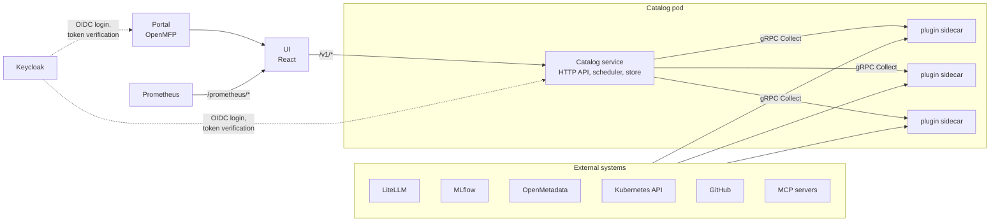

# Architecture

Naira consists of a catalog service, a set of plugins running next to it, a UI and a portal shell. Authentication is delegated to Keycloak. All of it is installed with one Helm chart into a Kubernetes cluster, next to the systems the plugins read from.

## Catalog service

The catalog is a Go service with a Chi HTTP router. It owns the graph of nodes and relations, exposes it through the [Catalog API](/documentation/api) and manages the plugins:

- At startup it reads a plugin configuration file that lists every plugin with its gRPC address and an optional cron schedule, connects to each plugin and exits if one is unreachable.
- A scheduler triggers plugin runs according to their cron expressions. Runs can also be started from the API and the portal.
- Every run is recorded as an operation, modelled after the [AIP-151](https://google.aip.dev/151) long-running operation: it has a start and end time, a done flag, and either an error message or the number of nodes and relations it upserted.
- A successful run replaces that plugin's previous snapshot in the store. See [Snapshots](/documentation/concepts#snapshots).

The store is in memory. The Helm chart already ships PostgreSQL, and persisting the graph there is in progress.

Every API request except the health check must carry a bearer token issued by Keycloak. The catalog verifies the token against the configured realm and accepts only tokens whose issuer matches its configuration.

## Plugins as sidecars

Each plugin is its own container image. The chart runs the enabled plugins as native sidecars (init containers with a restart policy) in the catalog pod. They listen on loopback only, so nothing outside the pod can reach them, and the catalog connects to them over localhost.

The contract between catalog and plugin is one gRPC service with one RPC, `Collect`, which returns the nodes and relations the plugin currently sees. Plugins carry no state between runs. Configuration comes from environment variables, mounted config files and Secrets. Plugins that read the cluster get their own RBAC rules through the chart.

This design is recorded in [ADR-005](https://github.com/naira-project/architecture/blob/main/adr/005-switch-to-grpc-sidecars.md). The plugin contract and how to implement it are described in [Writing a Plugin](/documentation/plugin-authoring).

## UI and portal

The UI is a React application that talks to the catalog API. It renders the overview, the catalogs, the detail pages, the Plugins page and the Tech Radar. It is served by nginx, which also proxies API calls to the catalog and, for the metric panels, proxies queries to a Prometheus-compatible endpoint with the user's token enforced.

The portal is an [OpenMFP](https://openmfp.org/) portal built on Luigi. It provides the shell: login through Keycloak, the left navigation and the frame in which the UI pages are shown as micro-frontends. Navigation entries are declared in the portal's service provider configuration, which is how new pages become visible. The UI can also be opened on its own during development.

Metric panels on inference endpoint pages are built with [Perses](https://perses.dev/) components and PromQL queries, following [RFC-005](https://github.com/naira-project/architecture/blob/main/rfc/rfc-005-perses-embedded-dashboards.md).

## Authentication

Keycloak is the identity provider. The portal performs the OIDC login and holds the session. The UI passes the user's access token on every request to the catalog and to the Prometheus proxy. The catalog validates tokens with Keycloak and rejects anything else.

Keycloak itself is not part of the Naira chart. In the local environment it comes from the test-dependencies chart, with a `naira` realm, a `naira-portal` client and a test user.

## Deployment layout

The Helm chart installs the catalog Deployment with its plugin sidecars, the UI, the portal, a PostgreSQL StatefulSet with a database seeding Job, and the ConfigMaps, Secrets, RBAC and NetworkPolicy they need. External systems are addressed by URL in the plugin configuration. The consolidation of all deployment paths into this chart is described in [RFC-009](https://github.com/naira-project/architecture/blob/main/rfc/rfc-009-deployment-consolidation.md).

For development, a Tiltfile deploys the same chart with development values and the test-dependencies chart into a kind cluster. For CI, end-to-end scenarios deploy a scenario-specific subset of components into a fresh namespace and assert the resulting graph through the API.

## Further reading

Design discussions and decisions live in the [architecture repository](https://github.com/naira-project/architecture):

- [RFC-004](https://github.com/naira-project/architecture/blob/main/rfc/rfc-004-core-api-v1-design.md): the design of the core API
- [RFC-008](https://github.com/naira-project/architecture/blob/main/rfc/rfc-008-Kubernetes-Test-Environments-for-PR-Based-E2E-Testing.md): Kubernetes test environments for end-to-end testing
- [RFC-010](https://github.com/naira-project/architecture/blob/main/rfc/rfc-010-plugin-ecosystem.md): the plugin ecosystem
- [RFC-007](https://github.com/naira-project/architecture/blob/main/rfc/rfc-007-documentation-integration.md): documentation in context
